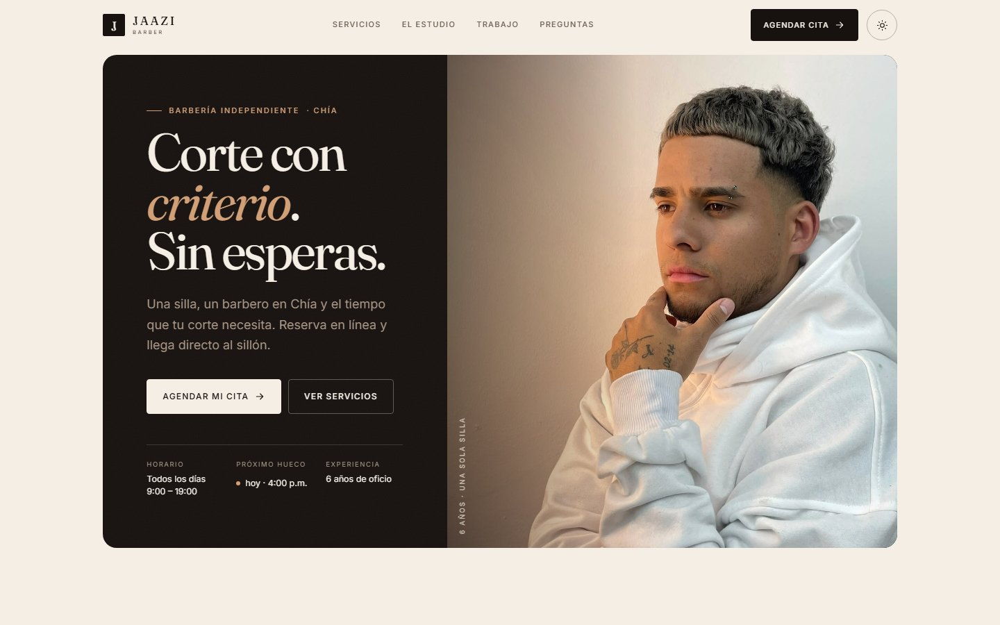
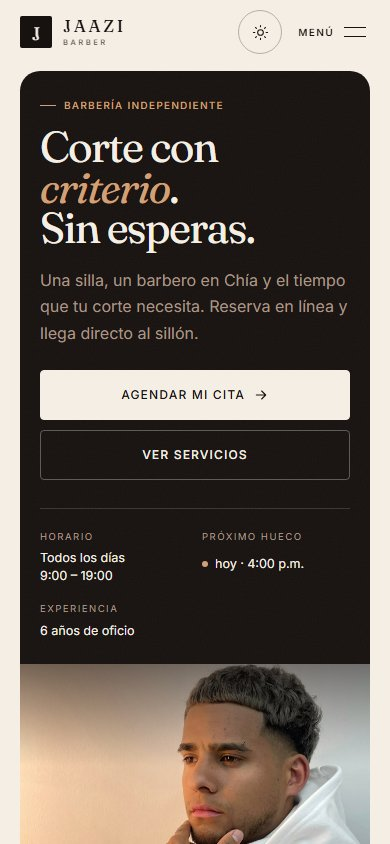
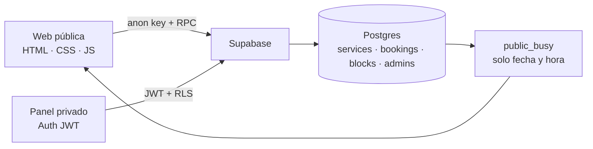
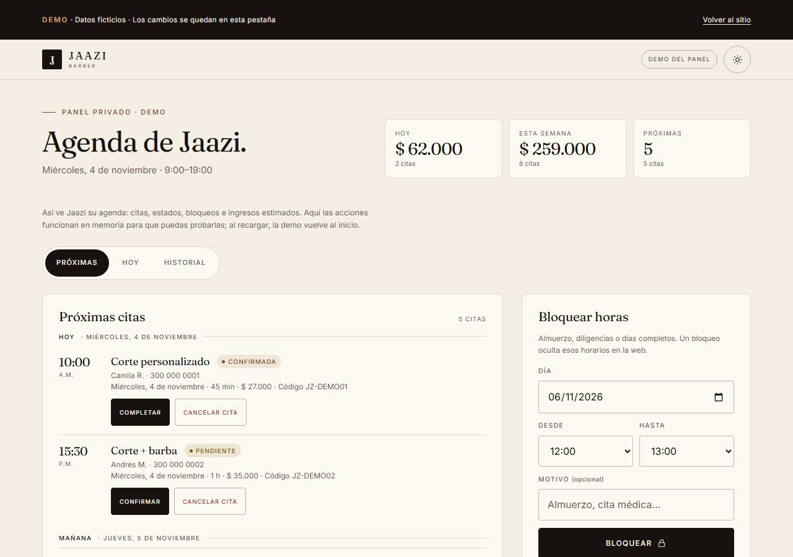

# Jaazi Barber

Sitio de reservas y agenda para una barbería de una sola silla en **Chía, Colombia**. La web permite reservar, cambiar o cancelar una cita sin llamar; el panel privado le da al barbero una vista única de su día, sus bloqueos y sus ingresos estimados.

[**Ver el sitio**](https://jaazibarber.netlify.app/) · [**Probar la demo del panel**](https://jaazibarber.netlify.app/panel-demo.html) · [**Evidencia de QA**](docs/qa.md) · [**Operación**](docs/operacion.md)



<p align="center"></p>

---

## El problema

Jaazi trabaja solo, en un estudio privado y siempre con cita previa. La agenda se gestionaba a mano: no había una vista compartida del día ni una forma de que el cliente reservara, cambiara o cancelara por su cuenta. Cada movimiento dependía de una conversación y de que alguien recordara el hueco.

El objetivo era doble: que el cliente complete una reserva en tres pasos, y que Jaazi pueda operar la agenda desde el móvil sin depender de recordatorios manuales.

## Mi rol

Proyecto real, de principio a fin y sin equipo:

- Dirección de arte y diseño de la interfaz.
- Frontend en HTML, CSS y JavaScript, sin build ni dependencias.
- Modelo de datos, funciones SQL, vistas y políticas RLS en Postgres.
- Integración con Supabase (REST, RPC y Auth).
- Despliegue, automatización y QA.

## Qué construí

**Web pública**

- `index.html`: propuesta de valor, servicios con precios, estudio, trabajo real, FAQ y datos estructurados.
- `agendar.html`: reserva en tres pasos (servicio → día y hora → datos), con confirmación, código y archivo `.ics`.
- `revisar.html`: consulta con **código + teléfono**, cambio de fecha y hora, y cancelación.
- `privacidad.html`: política de tratamiento conforme a la Ley 1581 de 2012.

**Panel privado**

- Login con Supabase Auth y autorización por tabla `admins`.
- Métricas de hoy, semana y próximas citas.
- Confirmar, completar y cancelar; historial; ingresos estimados.
- Bloqueos de horas o días completos, con validación de solapamientos.

**Backend**

- Postgres con `services`, `bookings`, `blocks` y `admins`.
- Vista `public_busy` que expone **solo fecha, hora de inicio y hora de fin**; nunca nombres, teléfonos ni códigos.
- Funciones `create_booking`, `lookup_bookings`, `cancel_booking` y `reschedule_booking` como `SECURITY DEFINER`.
- RLS activo: el rol anónimo no puede leer `bookings` ni `blocks`.
- Toda la lógica de jornada, zona horaria, bloqueos y solapamientos vive en la base de datos.

## Decisiones técnicas

**1. La agenda no se lee desde el cliente.**
El frontend nunca consulta `bookings`. La disponibilidad sale de `public_busy`, una vista sin datos personales, y cualquier operación sobre una cita pasa por una función que exige **código + teléfono**. Si la `anon key` se copia, no hay nada que enumerar.

**2. La base de datos es la fuente de verdad.**
`create_booking` y `reschedule_booking` validan en una sola transacción: jornada 9:00–19:00, zona `America/Bogota`, bloques, citas activas y solapamientos. El JavaScript no decide si un hueco es válido; solo muestra lo que la base confirma.

**3. Código + teléfono en vez de cuentas.**
Reservar no exige registro. Gestionar una cita exige el código de 6 caracteres **y** el teléfono con el que se reservó. Es menos fricción para el cliente y menos superficie de datos; el costo es que quien tenga ambos datos puede gestionar la cita, y así se explica en la política de privacidad.

**4. Sin build, sin dependencias.**
HTML, CSS y JavaScript vanilla; fuentes autoalojadas y Supabase por REST. El sitio se despliega como archivos estáticos y no tiene `node_modules`. El trade-off es DOM manual y cero framework; la ventaja es control total del peso y del HTML servido.

**5. Accesibilidad y SEO como requisitos, no como extra.**
Navegación por teclado, foco gestionado en el panel de cambio, objetivos táctiles de 44 px, contraste AA, `prefers-reduced-motion`, JSON-LD de `BarberShop` y `FAQPage`, sitemap y `llms.txt`.

## Arquitectura



| Tabla / vista | Función |
|---|---|
| `services` | Precio y duración autoritativos |
| `bookings` | Citas, estados y datos del cliente; RLS sin lectura anónima |
| `blocks` | Horas bloqueadas por el barbero |
| `admins` | Correos autorizados para el panel |
| `public_busy` | Disponibilidad sin datos personales |

El esquema completo está en [`supabase/schema.sql`](supabase/schema.sql).

## Resultados verificables

- **0 errores** del validador W3C en las cuatro páginas públicas del repositorio.
- **0 violaciones** de axe-core WCAG 2.0/2.1 A/AA en home, reserva, revisión y demo.
- Contraste **5.76:1 / 6.48:1** en texto secundario y **5.25:1 / 6.94:1** en tarjetas de historial.
- Objetivos táctiles de **44 px** en footer, acciones de cita y botones del editor.
- **CLS 0.0009**; **300 KB y 16 peticiones** en la portada móvil (44 % menos que antes), con AVIF/WebP y `srcset` en el héroe y la galería.
- Flujos probados con Playwright: reservar, consultar, cambiar fecha/hora, cancelar, reintentar disponibilidad y foco del editor.

Los números, el método y los pendientes están en [`docs/qa.md`](docs/qa.md).

## Demo del panel

[**Abrir la demo**](https://jaazibarber.netlify.app/panel-demo.html)



Es una copia del panel con datos ficticios y acciones en memoria: puedes confirmar, completar, cancelar y bloquear horas. No se conecta con Supabase, no toca la agenda real y se reinicia al recargar. Existe para que el panel sea evaluable sin credenciales.

## Stack

| Capa | Decisión |
|---|---|
| Frontend | HTML5 semántico, CSS con custom properties y Grid, JavaScript vanilla |
| Backend | Supabase: Postgres, RLS, funciones RPC y Auth |
| Hosting | Netlify (principal) y GitHub Pages (respaldo) |
| CI | GitHub Actions: empaqueta y publica en cada push a `main` |
| QA | W3C Nu, axe-core, Playwright, pruebas manuales de teclado |
| Tipografía | Fraunces e Inter, autoalojadas en `woff2` |

## Cómo ejecutarlo

```bash
python -m http.server 4173 --bind 127.0.0.1
```

Abre `http://127.0.0.1:4173/`. Sin configuración de Supabase, la reserva funciona en modo local con `localStorage`; el panel privado necesita el backend.

Para conectar la agenda real, credenciales, migraciones y despliegue, consulta [`docs/operacion.md`](docs/operacion.md).

## Estructura

```
assets/
  css/      site.css, booking.css, panel.css, demo.css
  js/       config.js, api.js, store.js, site.js, booking.js, review.js, panel.js
  fonts/    Fraunces + Inter (woff2, self-hosted)
  img/      retrato, trabajo real y imagen social 1200×630
docs/       qa.md, operacion.md y capturas
supabase/   schema.sql y migraciones
panel-demo.html
```

## Documentación

- [`docs/qa.md`](docs/qa.md): evidencia, mediciones y pendientes.
- [`docs/operacion.md`](docs/operacion.md): Supabase, despliegue, respaldo y entrega.
- [`supabase/schema.sql`](supabase/schema.sql): esquema, RLS y funciones.
- [`llms.txt`](llms.txt): resumen del negocio para asistentes generativos.

## Licencia y créditos

Proyecto de portafolio de [@georgemm28d](https://github.com/georgemm28d). La marca, los textos y las fotografías de Jaazi Barber se muestran con permiso del cliente y no se licencian para reutilización. El código se comparte para evaluación técnica.
